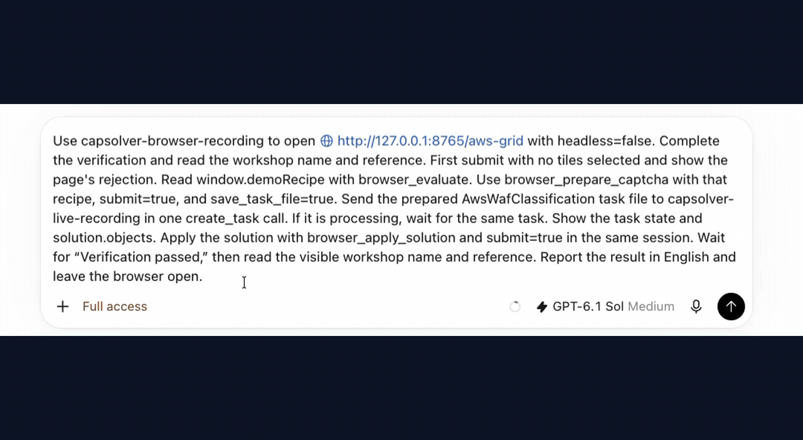
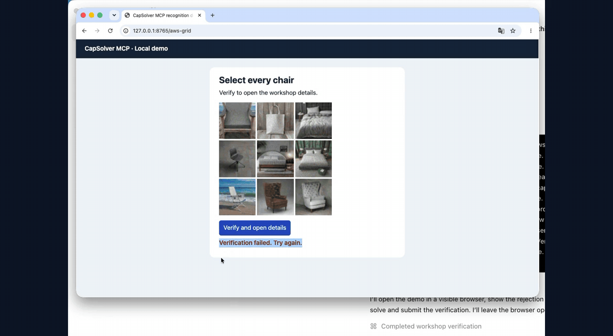

<!-- mcp-name: io.github.capsolver-ai/capsolver-mcp -->

# capsolver-mcp

Connect an MCP client to CapSolver for CAPTCHA solving and image recognition. Add a browser service to read a challenge from a page, apply the solution in the same tab, and check the website's response.

[Installation](docs/mcp-integration.md) · [Coverage](docs/coverage.md) · [Upgrade guide](docs/migration.md) · [Troubleshooting](docs/troubleshooting.md) · [Support](SUPPORT.md)

## Contents

- [Install with one prompt](#install-with-one-prompt)
- [Manual setup](#manual-setup)
- [First call](#first-call)
- [Usage examples](#usage-examples)
- [Browser modules](#browser-modules)
- [Supported MCP tools](#supported-mcp-tools)
- [Coverage](#coverage)
- [Upgrade from 0.1.x](#upgrade-from-01x)
- [Troubleshooting](#troubleshooting)
- [Frequently asked questions](#frequently-asked-questions)
- [Codex Desktop demo](#codex-desktop-demo)

## Install with one prompt

Copy this prompt into a coding agent with access to your local terminal.

~~~text
Install the latest release of capsolver-mcp from PyPI and connect it to my MCP client over STDIO.
Read CAPSOLVER_API_KEY from the core server process environment.
Use env.CAPSOLVER_API_KEY in my local MCP client settings to pass it to the process, then call get_account_balance to verify the live connection.
Confirm execution_mode: provider.
If the key is missing, ask me to configure it locally before the live check.
Run with --offline only if I explicitly request a simulation.
~~~

For a live balance check, set `env.CAPSOLVER_API_KEY` in your local MCP client configuration. The client passes it to the core MCP process as the `CAPSOLVER_API_KEY` environment variable when it starts.

## Manual setup

### Installation

Install Python 3.10 or later and open a terminal in the folder where you want to create the virtual environment.

Check `python3 --version` on macOS or Linux, or `py -3 --version` on Windows. If the command reports an older version, use the command for your newer installation to create `.venv` (for example, `python3.12` or `py -3.12`). The commands below install the latest release from PyPI.

**macOS / Linux**

```sh
python3 -m venv .venv
.venv/bin/python -m pip install --upgrade capsolver-mcp
```

**Windows PowerShell**

```powershell
py -3 -m venv .venv
.\.venv\Scripts\python.exe -m pip install --upgrade capsolver-mcp
```

For a source install, download `capsolver-mcp.zip` from the [latest GitHub release](https://github.com/capsolver-ai/capsolver-mcp/releases/latest). From the extracted directory, run `python -m pip install .` with your virtual environment’s Python.

Find your API key in the CapSolver dashboard using the [API quickstart](https://docs.capsolver.com/en/guide/getting-started/). Replace `YOUR_API_KEY` with the API key in your local client settings.

### STDIO

```json
{
  "mcpServers": {
    "capsolver": {
      "command": "capsolver-mcp",
      "env": {
        "CAPSOLVER_API_KEY": "YOUR_API_KEY"
      }
    }
  }
}
```

For a fresh `.venv` installation, set `command` to the absolute path of the installed executable. Use `/absolute/path/to/.venv/bin/capsolver-mcp` on macOS or Linux, or `C:\\path\\to\\.venv\\Scripts\\capsolver-mcp.exe` in Windows JSON. The short command `capsolver-mcp` works when the executable is on the MCP client’s PATH.

For Claude Desktop, add the entry to `claude_desktop_config.json` via **Settings → Developer → Edit Config**, then quit and reopen the app. For Cursor, add it to `~/.cursor/mcp.json` or the project's `.cursor/mcp.json`.

On macOS or Linux, you can also register the server with Codex from the directory where you created `.venv`.

```sh
codex mcp add capsolver-mcp \
  --env 'CAPSOLVER_API_KEY=YOUR_API_KEY' \
  -- "$PWD/.venv/bin/python" -m capsolver_mcp
```

## First call

### Check the connection

Reconnect the client and check for 15 core tools.

Call `get_account_balance`. A successful live response includes `ok: true`, `execution_mode: provider`, and a numeric `account.balance`. The core sends the configured API key to CapSolver as `clientKey`.

Without a key, the client can still list tools. Live calls report `Configure CAPSOLVER_API_KEY first.`. For an explicit simulation, start the core with `--offline` and expect `execution_mode: offline_simulated` and a simulated balance.

### Submit a task

Use `list_task_types` and `get_task_schema` to choose the task and check its fields. **Generate and save a unique `request_id` before submitting**, then pass it to `create_task` or `get_token`. If the state is `processing`, call `wait_for_result` with the existing `task_id`. Read `solution` when the state is `ready`. If the submission response is missing, look up your saved ID with `get_request_status`.

### Request recovery and persistence

Within the same account and operator, submitting the same ID with identical request parameters returns the existing record. Changing the task, endpoint, app ID, or callback URL with that ID produces an error.

In live mode, request metadata stays in local SQLite across restarts when you reuse the same state directory, API key, and operator. Records have no automatic expiry. Provider result queries are limited to five minutes from submission and at most 120 queries. Solutions are cached in memory. A synchronous solution can become unavailable after restart or cache eviction.

## Usage examples

### Offline simulation

In an offline session, ask your client to run this example.

> Use capsolver-mcp to look up `ReCaptchaV2TaskProxyLess`, create a simulated task with `websiteURL: https://example.com/` and `websiteKey: demo-site-key`, and wait on the returned task ID if the task is processing. Report the final state and execution mode.

The simulation should return `state: ready` and `execution_mode: offline_simulated`.

## Browser modules

Add either browser service separately in your MCP client. Configure the CapSolver API key on the solver service. The commands below use macOS and Linux paths. On Windows, use the corresponding Python executable from the virtual environment.

### Python browser service

```sh
.venv/bin/python -m pip install --upgrade 'capsolver-mcp[browser]'
.venv/bin/python -m playwright install chromium
```

- **STDIO**: Use the same Python executable with `-m capsolver_mcp.browser_server` as its arguments.

### Patchright browser service

Use Node.js 22, npm, and Google Chrome. Build from the `browser-patchright` source directory or install the matching tarball from the release assets.

```sh
npm ci --ignore-scripts
npm run build
```

- **STDIO**: Use `node` as the command and pass these arguments in order: `/path/to/capsolver-mcp/browser-patchright/dist/index.js`, `--workflow-python`, and `/path/to/capsolver-mcp/.venv/bin/python`.

## Supported MCP tools

### Solver service (15 tools)

| Tool | Purpose |
| --- | --- |
| `get_account_balance` | Check the CapSolver account balance. |
| `get_balance` | Alias for `get_account_balance`. |
| `list_task_types` | List locally cataloged task types and their requirements. |
| `get_supported_tasks` | List supported task types and show information from the official documentation in online mode. |
| `get_task_schema` | Get task inputs, outputs, conditional fields, and examples. |
| `get_task_parameters` | Look up task parameters and any available official references. |
| `get_docs` | Read usage guidance or official documentation. |
| `refresh_task_catalog` | Refresh official documentation data and report differences from the local catalog. |
| `get_actual_user_agent` | With `task_id`, read the User-Agent from an existing task result of any type. Omit `task_id` to look up documented DataDome User-Agent values. |
| `create_task` | Submit a CAPTCHA solving or image recognition task. |
| `get_token` | Get a token synchronously for a supported reCAPTCHA task type. |
| `get_task_result` | Look up task status and results by task ID. |
| `wait_for_result` | Wait for an existing task. Set `timeout` in seconds. |
| `get_task_result_wait` | Wait for an existing task using `timeout_seconds`. |
| `get_request_status` | Look up a submission by request ID, including after a connection interruption. |

### Python browser service (13 tools)

| Tool | Purpose |
| --- | --- |
| `browser_open` | Open a browser session or attach to an existing Chromium page. |
| `browser_inspect` | Inspect the page and form state. |
| `browser_action` | Navigate, fill fields, click, wait, or take a screenshot. |
| `browser_detect_captchas` | Detect CAPTCHAs on the page. |
| `browser_prepare_captcha` | Collect and prepare parameters for a solving task. |
| `browser_apply_solution` | Apply the full solution to the original page and optionally submit and verify the result. |
| `browser_evaluate` | Run JavaScript in the page or a selected frame. |
| `browser_network_requests` | List recorded network response summaries. |
| `browser_add_init_script` | Add an initialization script that runs before page scripts. |
| `browser_capture_responses` | Configure capture of future original responses. |
| `browser_get_response` | Read captured response content. |
| `browser_api_request` | Send an HTTP request using the browser session context. |
| `browser_close` | Close the session or disconnect from the browser. |

### Patchright browser service

Patchright exposes 66 native tools. The `--workflow-python` option adds 13 workflow tools with the `capsolver_` prefix, for a total of 79. Open the target page, attach its tab with `capsolver_browser_attach`, and use the returned IDs with the prefixed workflow tools. For either browser service, verify the site's business response after applying the solution.

## Coverage

[Detailed coverage and requirements](docs/coverage.md)

The built-in catalog lists 25 task entries. Use `list_task_types`
to browse them and `get_task_schema` to check the selected type, required
fields, supported endpoints and proxy policy.

| Family | What to check |
| --- | --- |
| reCAPTCHA v2 and v3 | Match the standard, Enterprise or M1 variant where applicable. |
| Cloudflare | Choose Turnstile or Challenge. Cloudflare Challenge requires a matching sticky proxy session. |
| AWS WAF | Match the challenge parameters and proxy policy for the selected variant. |
| DataDome | Use the current slider challenge and the matching browser identity and proxy. |
| GeeTest | Match the challenge version (v3 or v4). |
| MTCaptcha | Check whether the selected variant requires your own proxy. |
| Image recognition | Check the input format for ImageToText, reCAPTCHA and AWS WAF classification, or the relevant VisionEngine module. |
| BotDeflector token | The catalog includes `AntiBotdeflectorTaskProxyLess`. Live API and browser end-to-end verification are pending. The VisionEngine `botdeflector` module is a separate image recognition feature. |

`get_token` supports eight standard and Enterprise reCAPTCHA variants. Use
`create_task` for other supported tasks. For browser workflows, verify the
website response after applying the result.

## Upgrade from 0.1.x

[Full migration guide](docs/migration.md)

1. Back up the old client configuration and keep its environment. Install
   the latest release in a separate environment with
   `python -m pip install --upgrade capsolver-mcp`.
2. Point the client's core entry at the new environment and keep the
   `capsolver-mcp` command and existing `env.CAPSOLVER_API_KEY` setting. If
   you used `CAPSOLVER_API_KEY_FILE`, remove it and set `env.CAPSOLVER_API_KEY`
   to the API key itself. File paths are invalid here. Register a separate
   browser service if your old workflow detected or solved a challenge on a page.
3. Reconnect, confirm 15 core tools, then run `get_account_balance`.

| 0.1.x tool | Current equivalent |
| --- | --- |
| `get_balance` | Use `get_account_balance` or the retained `get_balance` alias. Read `account.balance`. |
| `get_supported_captchas` | `list_task_types` and `get_task_schema` |
| `solve_captcha` | `create_task`, then `wait_for_result` if processing |
| `detect_captchas` | `browser_open` and `browser_detect_captchas` on the browser service |
| `solve_on_page` | Prepare the challenge, solve on the core, then apply and verify on the browser service. |

To roll back, restore the old client settings and environment, or pin
`capsolver-mcp==0.1.3` again.

## Troubleshooting

[Detailed troubleshooting guide](docs/troubleshooting.md)

| What you see | How to fix it |
| --- | --- |
| The server will not start, or Python reports `No module named capsolver_mcp` | Run the configured command with `--help`. Install the package with the same Python used to launch it. Use the absolute path if the client cannot find the executable. |
| The client shows only five tools or no browser tools | Point the core entry at the updated environment and reconnect. Expect 15 core tools. For browser work, register the second service and check its Chromium or Chrome installation. |
| `get_account_balance` reports a missing or invalid key | Set `CAPSOLVER_API_KEY` in the core service environment. Restart and expect `execution_mode: provider` with a numeric balance. |
| `ERROR_ZERO_BALANCE` or provider `http_status: 401` | Check account credit for `ERROR_ZERO_BALANCE`. Check the CapSolver API key on the core service if a tool reports provider status 401. |
| `INVALID_PARAMETERS` or `ERROR_INVALID_TASK_DATA` when creating a task | Look up the exact type with `get_task_schema` and check required fields, endpoint and proxy policy. |
| `WAIT_TIMEOUT` with a task ID | Continue waiting on the original `task_id` while it remains queryable. |
| Missing response, `acceptance_unknown`, or `NOT_FOUND` | Call `get_request_status` with the saved `request_id`. If it returns a processing task, use that task ID. For `NOT_FOUND`, verify the request ID, state directory, API key, and operator. If the outcome remains uncertain, keep the ID and contact support before resubmitting. A new ID can create a second paid task. |
| CapSolver returned a User-Agent that differs from the current browser | Check `solution.userAgent`, or call `get_actual_user_agent(task_id=...)` for the original task. The Agent prompt requires the returned User-Agent for applying or submitting the token. If the current session cannot use it, the Agent reports the mismatch and leaves the page untouched. |
| `STALE_CHALLENGE` or the website rejects a ready result | Prepare the current challenge again in the original tab. Check the proxy and browser identity when required. After applying a result, verify the site's own success message or business response. |

## Frequently asked questions

### Can I connect only the core service?

Yes. The core can submit tasks with
known inputs. Add a browser service to read challenges from a page, apply
results, or check whether the site accepted them.

### Where do I store the API key?

Set `CAPSOLVER_API_KEY` in the core service environment.

### Can I check the connection before adding a key?

Yes. Connect and list tools without a key. For a simulated balance check, explicitly start the core with `--offline` and look for `execution_mode: offline_simulated`.

### How do I find the right task type and proxy settings?

Start with
`list_task_types`. Read the selected task's fields and proxy policy with
`get_task_schema`.

## Codex Desktop demo

**1. Submit a task.** A prompt in Codex Desktop starts the local demo, and the CapSolver MCP tool calls prepare the image challenge and request a classification.



**2. Verify the result.** The browser demo shows a failed attempt before any images are selected. After applying the classification result, the page confirms verification and Codex reports the workshop details.



---

License: [MIT](LICENSE).
